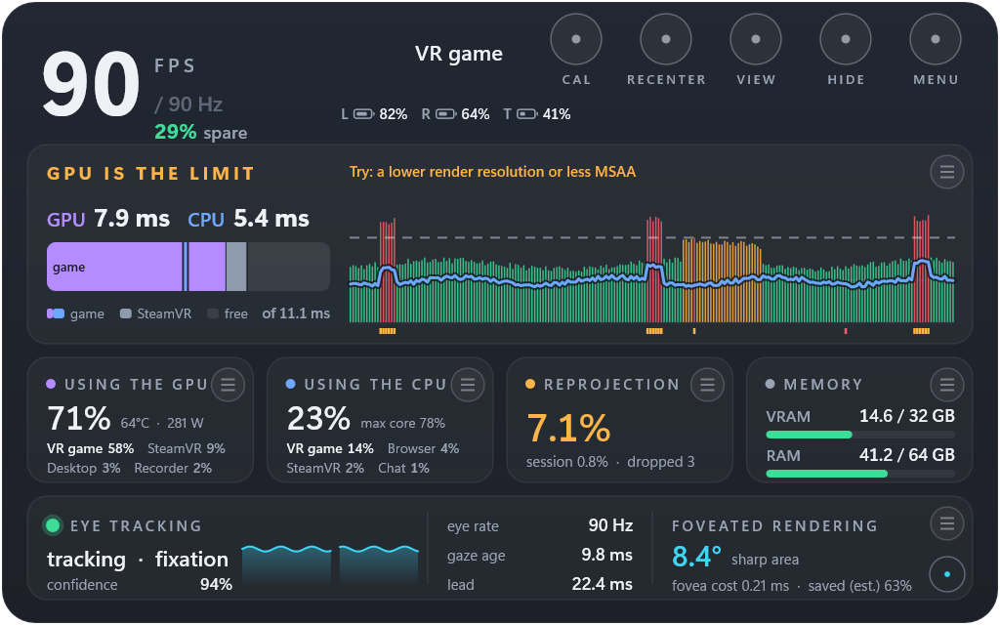

# LegendPanel

https://github.com/user-attachments/assets/a2c4e61c-8a13-4e4a-b75e-2e55a29b470a

A performance panel for SteamVR. It sits on your wrist or in the room and shows your frame rate, frame times, GPU and CPU use, memory, batteries and eye tracking, without leaving VR. Free to use.

## What's new in 1.0
- First release.

## Download
Get **LegendPanel.exe** from the [latest release](https://github.com/Encapsulation/LegendPanel/releases/latest). It's a single file: no installer, nothing to unpack.

> Windows may show "Windows protected your PC" the first time, because the app isn't code-signed yet. Click **More info**, then **Run anyway**.

> **VirusTotal (1.0.0):** [0 of 71 security vendors flagged it](https://www.virustotal.com/gui/file/21225a007f96a74c1f4daf129ed51dbe3fc5a5ebf3c29e6b6d3586a4e27bfb4f)  
> SHA256: `21225a007f96a74c1f4daf129ed51dbe3fc5a5ebf3c29e6b6d3586a4e27bfb4f`

## Requirements
- Windows 10 or 11 (64-bit)
- SteamVR
- Any SteamVR headset. Index, Quest/Touch, Vive, Windows Mixed Reality, Cosmos and Reverb G2 controllers are supported.
- For eye tracking, the eye-tracked menu and the LegendEye remote: [LegendEye](https://github.com/Encapsulation/LegendEye) 5.0 or later

## Getting started
1. Run LegendPanel.exe. It starts in the Windows tray, with no window.
2. Put on your headset. The first time, the panel asks whether to start with SteamVR. Look at **Yes** or point your laser at it.
3. Turn your left wrist toward you to see the panel. Squeeze the grip with your other hand to pick it up and move it. Let go on a wrist to wear it there, or anywhere else to leave it in the room.

You can also open the panel from its button in the SteamVR dashboard's bottom bar, and change every setting from the tray icon.

## Features
- **Frame card:** frames per second against your headset's refresh rate, spare headroom, and a frame-time graph. One bar shows where each frame's time goes (game, SteamVR, free), or switch to separate GPU and CPU bars. It names the limit (GPU or CPU) and suggests what to change.
- **Usage cards:** GPU and CPU use, GPU temperature and power, the busiest CPU core, reprojection and dropped frames, VRAM and RAM.
- **Per-app usage:** the apps using the GPU, the CPU and memory. The view button at each card's top right switches to a full list. Point your laser at a list and use the thumbstick to scroll.
- **Eye tracking card:** tracking state, confidence, eye camera rate, gaze age and foveated rendering status from LegendEye.
- **Batteries:** controllers and trackers.
- **Placement:** on either wrist like a watch, or pinned in the room.
  - Grab with the grip (or by touching it), tilt and turn it, and drop it where you want.
  - Pull your hands apart or together to resize; the size stays wherever it goes.
  - Use the thumbstick to push it away or pull it closer while holding it.
  - Grip strength is adjustable.
- **Show when:** always, when you look at it with your head, or when you look at it with your eyes (LegendEye). On the wrist it fades out when you look away; the room panel can too (off by default). It is invisible from behind.
- **Eye-tracked menu (with LegendEye):** look at a button to press it. Large round targets, labels you can read without pressing, a look time from 0.5 to 2 seconds, optional smoothing, snapping to the button you mean, and a choice of cursors. Grid and ring layouts.
- **Laser:** point with either controller and press with the trigger. Six colors and four angles.
- **LegendEye remote:** pause or resume tracking, recenter (1 or 5 dots), face tracking, expressions, sending to the game, and foveated rendering presets, all from the panel.
- **Streamer mode:** hides the time and the app lists for recordings and streams.
- **Sounds:** soft hover and press clicks (optional).
- **Light on your PC:** under 0.1 ms of GPU time per redraw while shown, and sampling runs on its own low-priority thread. While hidden it draws nothing and stops reading the sensors and app usage.

## Settings
Settings are saved in `%LOCALAPPDATA%\LegendEye\info_panel.json`. Start with SteamVR can be turned on or off under **Tools** in the panel's menu or from the tray icon.

## License
Free to use. See [LICENSE.txt](LICENSE.txt) and [THIRD_PARTY_NOTICES.txt](THIRD_PARTY_NOTICES.txt).
