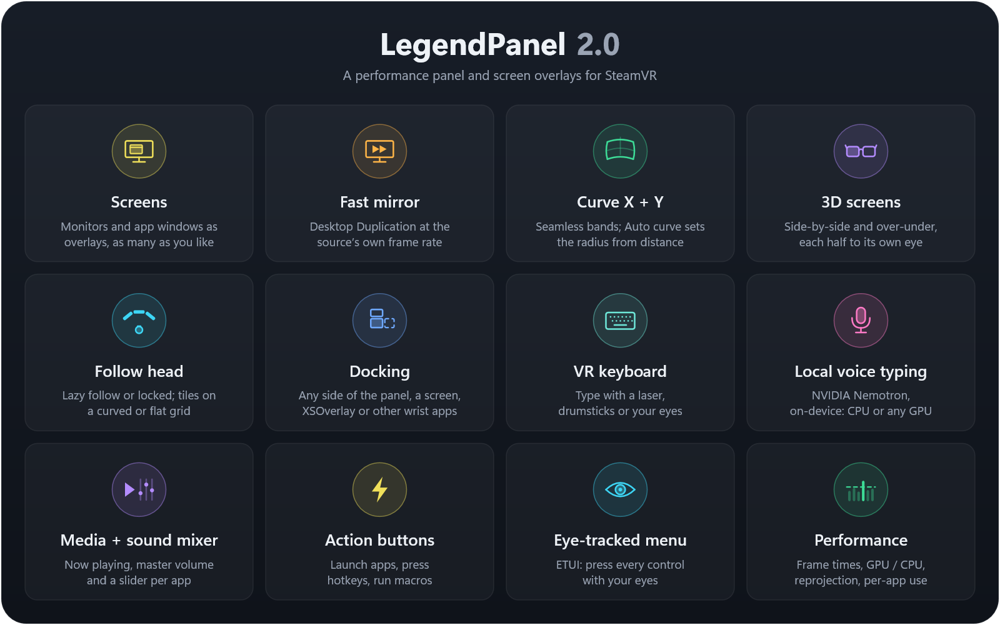
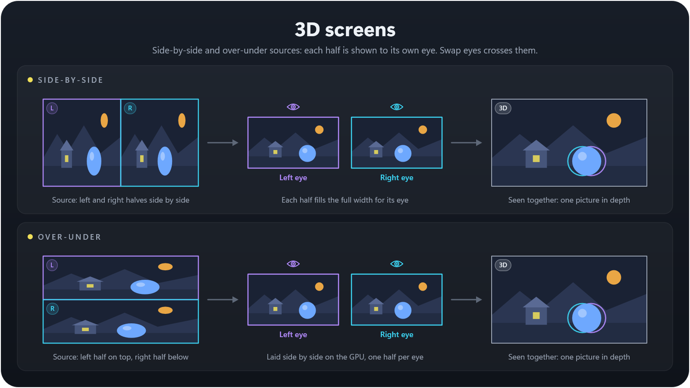
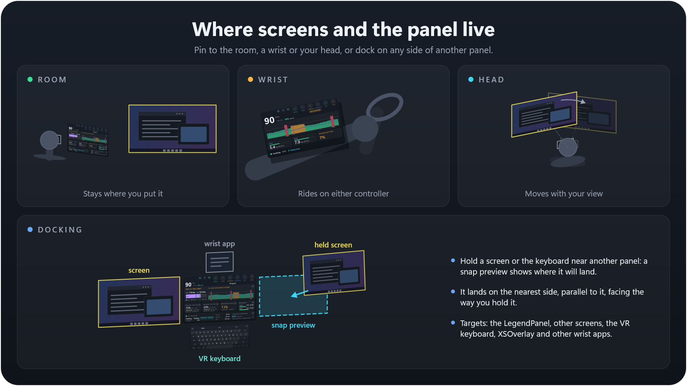
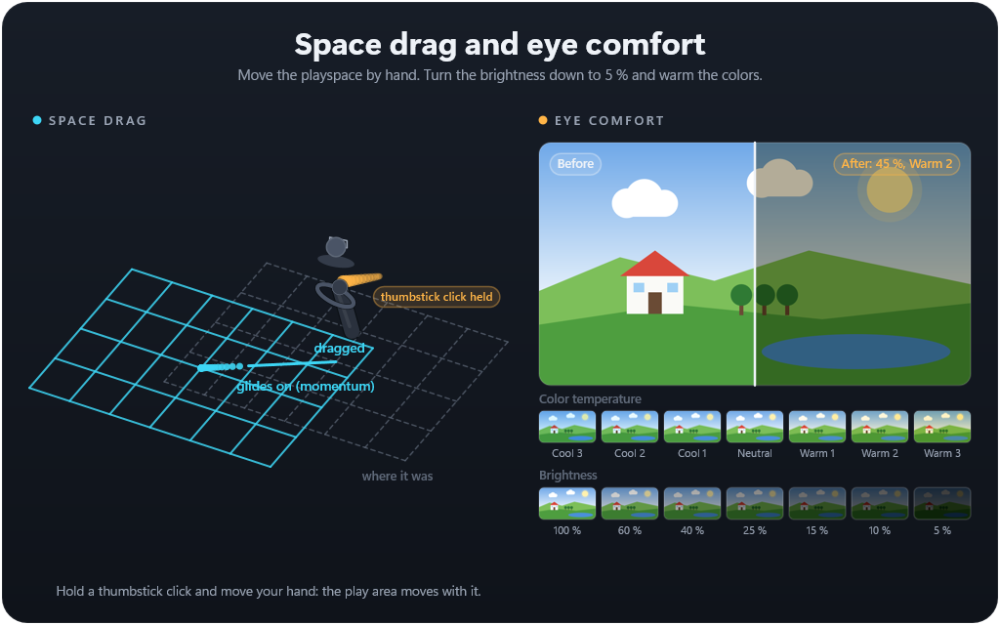
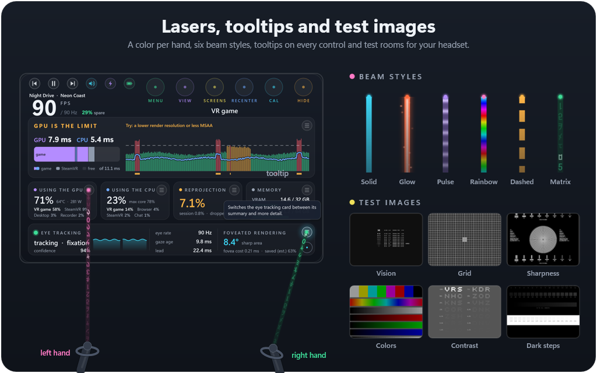
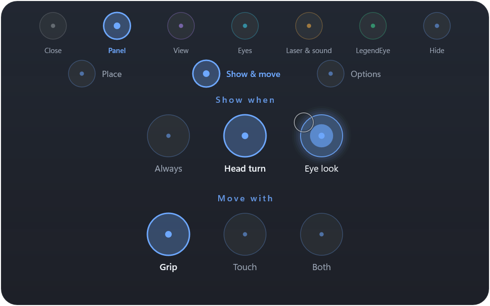
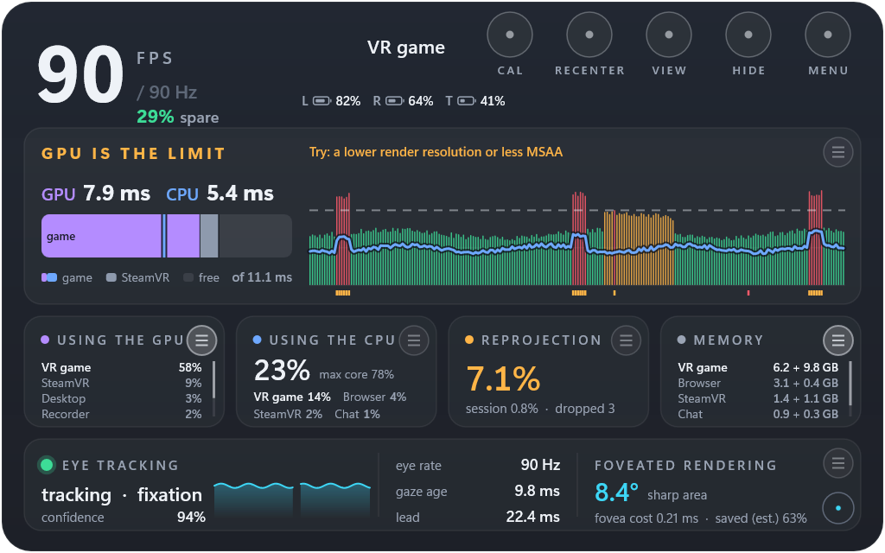

# LegendPanel

LegendPanel is a SteamVR panel that sits on your wrist or in the room. It shows your frame rate, frame times, GPU and CPU use, memory, batteries and eye tracking without leaving VR. With 2.0 it also puts your monitors and app windows in VR, with a keyboard, voice typing and full control over how everything docks and moves. Free to use.

## What's new in 2.0

### Screens
- Monitors and single app windows as overlays (Windows Graphics Capture), as many as you like, restored after a restart.
- Menus, dropdowns and dialogs that reach past a window's edge get overlays of their own: fully clickable, movable on their own, and docked back onto their window when you let go over it or beside one of its edges.
- Fast mirror: DXGI Desktop Duplication at the source's own frame rate (exclusive fullscreen included) for games, emulators and 3D apps, with low-latency laser updates paced to the headset's frames.
- Curve X and Y (seamless bands) and Auto curve (radius = distance × an adjustable ratio, sideways or both ways); width, opacity, brightness, contrast and tint.
- 3D: side-by-side and over-under, each half to its own eye, with swap eyes.
- Follow the active window; webcam and capture-card sources; optional Windows notifications as cards.
- A control bar under each screen, shown when your laser or your eyes come near it: keyboard, pin, curve, opacity, lock, close. It moves to whichever outer edge is free.
- Laser mouse: move, click and scroll. Lock a screen to make it click-through.
- Layouts: save and load screen arrangements, optionally per game. Bring here and RECENTER bring back lost screens. Optional gaze fade.

### Docking and moving
- Pin to the room, a wrist or your head. Dock on any side of the panel, another screen, XSOverlay or other wrist apps, facing the way you hold it (a quarter turn too), with a snap preview. Docked groups move, pin and dock as one.
- Screens docked side by side, and the panel beside them, form one curved unit. Or fold flat at the seams to face you (Auto angle). Fold any docked surface by its edge handle in 15° steps that hold.
- Surround: your screens around you in one or two rows, with adjustable distance and wrap.
- Throw (optional): let go while moving and it keeps going, with adjustable strength, friction, spin and range. It docks onto a wrist, a panel or a screen it passes.
- Two hands move, turn and resize anything you hold.
- Follow head: the panel and every screen can be Off, Lazy follow (adjustable dead zone, catch-up and height) or Locked to view. Several following surfaces tile without overlapping, wrapped around you or on a flat wall.

### VR keyboard and voice typing
- Full layout with number row, symbols and emoji; QWERTY, AZERTY, QWERTZ and Dvorak; text shortcuts; word suggestions from a 30,000-word model.
- Type with either laser, with the controller tips (drumstick), or with your eyes: free dwell, or assisted typing that weighs the gaze against the next likely letter and shortens the dwell for likely keys.
- Themes (Panel, Midnight, Light, Neon, Beige, Gray and Black caps), any accent color, key and board opacity, key sound packs (Soft, Thock, Creamy, Clacky, Clicky, Typewriter) and haptics.
- Opens under the screen you clicked. Dock it anywhere or pin it to either wrist; its button brings it back if it gets lost.
- Voice typing runs on your PC: NVIDIA Nemotron Speech Streaming 0.6B through NeMo-Speech.cpp, built into the exe. Live text while you speak; push to talk or hands-free (Silero VAD). It runs on Auto, the CPU or any GPU (Vulkan). The model (700 MB) downloads on first use and is verified. Windows speech is the fallback.

### Media, sound and actions
- Now playing with previous, play/pause and next at the top left of the panel.
- Sound: master volume, a slider per app, output device and mic mute.
- Action buttons: launch an app, file or web page, press a hotkey, run a macro, or trigger panel actions. Make them in VR or in the desktop window.
- Batteries show only when low; the device list holds 16 devices.

### Space drag and eye comfort
- Space drag: hold a thumbstick click, or buttons you record, and move your hand to move the playspace. Adjustable speed, momentum and optional gravity. Fix floor and Reset space sit beside it under **Tools**.
- Eye comfort: brightness down to 5 % and color temperature in half steps, cooler or warmer.

### Lasers and test images
- A color per hand, with buttons to copy one hand's color to the other. Six beam styles that look round from every side: Solid, Glow, Pulse, Rainbow, Dashed and Matrix. An optional shimmering cursor, and lasers that can stay on. The dot is its own overlay on the beam's tip, so it never lags behind the beam.
- Tooltips: rest your laser on any control to see what it does.
- Test images for checking your headset, all on dark backgrounds: sharpness charts, an eye chart with an astigmatism dial, a grid, white on black, colors, contrast and dark steps.

### The panel and its menu
- Menu redesigned: centered and symmetric, labeled slider stops you can press with your eyes, a click and a haptic tap on every slider step. Tabs: Panel, Look, Laser, Tools, Sound, ETUI, LegendEye.
- Tools: Space Setup, Display, Playspace, Throw.
- ETUI: one switch for eye control, look to press on its own switch, look time 0.3 to 3 s.
- Haptics: light, medium or strong, with optional taps on press and ticks on hover.
- Settings backup (save, load, undo) and an update check that only tells you.
- Six sound packs (new: Glass, Bubble), each with its own resize sound.
- VRAM in use on AMD and Intel GPUs.

## Download
Get **LegendPanel.exe** from the [latest release](https://github.com/Encapsulation/LegendPanel/releases/latest). It's a single file: no installer, nothing to unpack.

> Windows may show "Windows protected your PC" the first time, because the app isn't code-signed yet. Click **More info**, then **Run anyway**.

> **VirusTotal (2.0.0):** [0 of 70 security vendors flagged it](https://www.virustotal.com/gui/file/44913b7d893046873f4adec46d6a023617d0b7b28ff38f9999f54ccc04a82c69)  
> SHA256: `44913b7d893046873f4adec46d6a023617d0b7b28ff38f9999f54ccc04a82c69`

## Requirements
- Windows 10 or 11 (64-bit)
- SteamVR
- Any SteamVR headset. Index, Quest/Touch, Vive, Windows Mixed Reality, Cosmos and Reverb G2 controllers are supported.
- For eye tracking, the eye-tracked menu and the LegendEye remote: [LegendEye](https://github.com/Encapsulation/LegendEye) 5.0 or later

## Getting started
1. Run LegendPanel.exe. It starts in the Windows tray, with no window.
2. Put on your headset. The first time, the panel asks whether to start with SteamVR. Look at **Yes** or point your laser at it.
3. Turn your left wrist toward you to see the panel. Squeeze the grip with your other hand to pick it up and move it. Let go on a wrist to wear it there, or anywhere else to leave it in the room.

You can also open the panel from its button in the SteamVR dashboard's bottom bar, and change every setting from the tray icon.

## Features
- **Frame card:** frames per second against your headset's refresh rate, spare headroom, and a frame-time graph. One bar shows where each frame's time goes (game, SteamVR, free), or switch to separate GPU and CPU bars. It names the limit (GPU or CPU) and suggests what to change.
- **Usage cards:** GPU and CPU use, GPU temperature and power, the busiest CPU core, reprojection and dropped frames, VRAM and RAM.
- **Per-app usage:** the apps using the GPU, the CPU and memory. The view button at each card's top right switches to a full list. Point your laser at a list and use the thumbstick to scroll.
- **Eye tracking card:** tracking state, confidence, eye camera rate, gaze age and foveated rendering status from LegendEye.
- **Batteries:** controllers and trackers; shown in the header only when one runs low, the full list under the battery icon.
- **Placement:** on either wrist like a watch, or pinned in the room.
  - Grab with the grip, tilt and turn it, and drop it where you want.
  - Pull your hands apart or together to resize (down to 2.5 cm on the wrist, 10 cm in the room); the size stays wherever it goes.
  - Use the thumbstick to push it away or pull it closer while holding it.
  - Grip strength is adjustable.
  - **Dock beside wrist apps:** hold the panel next to another app's wrist panel (XSOverlay and others) and a faint preview shows where it will snap: above, below, left or right. Let go there and it stays docked beside it, facing the same way. Let go anywhere else and it stays exactly where you put it. The gap is adjustable (the Gap slider under **Panel > Docking**).
- **Show when:** always, when you look at it with your head, or when you look at it with your eyes (LegendEye). On the wrist it fades out when you look away; the room panel can too (off by default). It is invisible from behind.
- **Eye-tracked menu, ETUI (with LegendEye):** look at a button to press it. Large round targets, labels you can read without pressing, a look time from 0.3 to 3 seconds, optional smoothing, snapping to the button you mean, and a choice of cursors. Grid and ring layouts. Everything eye-driven is off until you turn on eye control.
  - **CAL button:** if the eye cursor lands beside where you look, look straight at the center of the CAL button, point your laser at it too, and pull the trigger. The panel lines its eye cursor up with that spot. Each laser press after that keeps fine-tuning it (**Auto-tune eyes**, on by default).
- **Menu:** sliders for anything with a range (drag with the laser, look at a labeled stop, or the - / + ends), and a Simple mode that shows only the common pages (**Panel > Menu**).
- **Laser:** point with either controller and press with the trigger. Six colors or any custom color (look or point anywhere on the color field), four angles, the beam on or off, a pointer cursor of its own (dot, ring, cross, arrow, cone, none) and an adjustable beam width, under **Laser**.
- **LegendEye remote:** pause or resume tracking, recenter (1 or 5 dots), face tracking, expressions, sending to the game, and foveated rendering presets, all from the panel.
- **Fix floor:** press **Fix floor** (**Tools > Playspace**), put a controller on the floor while the countdown runs, and the floor is set to the bottom of that controller. Undo it from the tray icon.
- **Streamer mode:** hides the time and the app lists for recordings and streams.
- **Sounds and haptics:** six sound packs (Subtle, Melodic, Wood, Crisp, Glass, Bubble) under **Sound**; soft hover and press clicks; a click when you grab the panel, a light tick for each spot it can snap to, and a click and snap when you let go there (optional). Haptics (on by default, light / medium / strong) give a short tap in the hand on the same moments. Resizing plays the pack's own resize sound.
- **Light on your PC:** under 0.1 ms of GPU time per redraw while shown, and sampling runs on its own low-priority thread. While hidden it draws nothing and stops reading the sensors and app usage.

## Settings
Settings are saved in `%LOCALAPPDATA%\LegendEye\info_panel.json`. Start with SteamVR can be turned on or off under **Tools** in the panel's menu or from the tray icon.

## License
Free to use. See [LICENSE.txt](LICENSE.txt) and [THIRD_PARTY_NOTICES.txt](THIRD_PARTY_NOTICES.txt).

## Demo
https://github.com/user-attachments/assets/a2c4e61c-8a13-4e4a-b75e-2e55a29b470a
