# LegendPanel

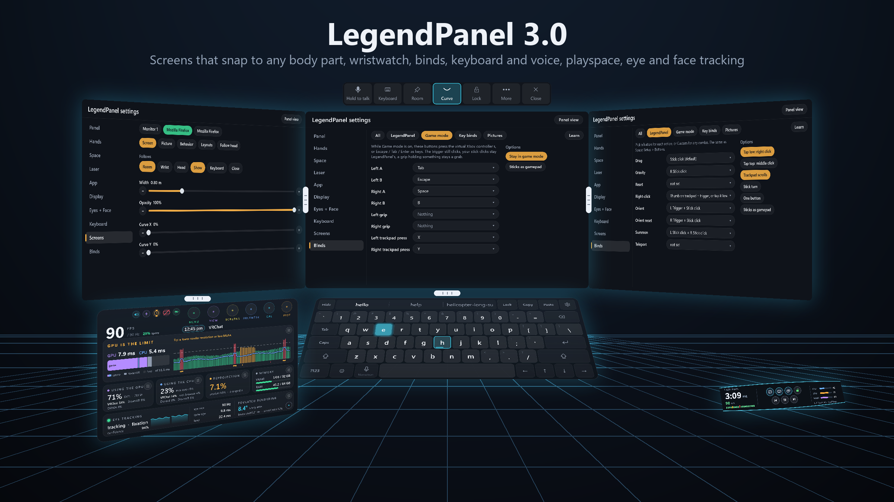

LegendPanel is a SteamVR panel that sits on your wrist or in the room. It shows your frame rate, frame times, GPU and CPU use, memory, batteries and eye tracking without leaving VR. It also puts your monitors and app windows in VR as overlays you dock into hinged assemblies that curve, fold and follow you, and snap screens, the keyboard and the panel to any body part you wear a tracker on, with a wristwatch, a fast VR keyboard, local voice typing on your GPU, every bind on one page, Game mode for any game, media and sound controls, space drag, eye comfort, laser styles, headset test images and, with LegendEye, eye and face tracking controls. Free to use.

## ⬇️ Download

One file: no installer, nothing to unpack. To update, replace the exe; your settings are kept. [All releases](https://github.com/Encapsulation/LegendPanel/releases)

**VirusTotal (4.0.0):** [0 of 68 security vendors flagged it](https://www.virustotal.com/gui/file/bdff945e7121df2bf30b2eef2c537b5763de8c17f78a382a1d7c91df2a2d828e)  
SHA256: `bdff945e7121df2bf30b2eef2c537b5763de8c17f78a382a1d7c91df2a2d828e`

Windows may show "Windows protected your PC" the first time, because the app isn't code-signed yet. Click **More info**, then **Run anyway**.

## Features

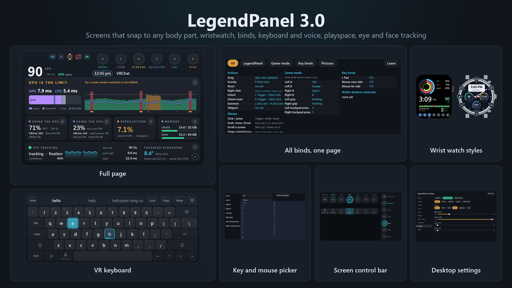

### Performance at a glance
- **Frame card:** FPS against your headset's refresh rate, spare headroom and a frame-time graph. One bar shows where each frame's time goes (game, SteamVR, free), or separate GPU and CPU bars. It names the limit and suggests what to change.
- **Usage:** GPU and CPU use, GPU temperature and power, the busiest core, reprojection and dropped frames, VRAM and RAM, and the apps using each.
- **Batteries:** controllers and trackers, shown when one runs low.
- **Eye tracking card** with LegendEye: tracking state, confidence, camera rate and foveated rendering.
- Light on your PC: under 0.1 ms of GPU per redraw, and nothing at all while hidden.

### Screens in VR
- Any monitor or app window as an overlay, as many as you like, restored after a restart. Fast mirror for games and 3D apps at their own frame rate.
- Dock screens, the keyboard and the panel into assemblies that hinge at every joint. Grip a joint and push, pull or use the stick; lock an outer edge and both sides bend while everything stays flush.
- Curve sideways and up-down, auto curve, one continuous curve across a docked row, 3D side-by-side and over-under.
- Resize with two hands, or one hand at a corner (grip it or aim at it). Docked screens stay centered.
- A control bar on every screen: keyboard, pin, curve, lock, voice typing, Game mode, size, opacity, Make Parent, Hide group, Recenter, Lock edge.
- Snap to any body part: hold a screen, the keyboard or the panel near a tracker and a preview shows where it goes. Pick which body parts count (waist, chest, feet, knees, arms, others).
- Pin to the room, a wrist, your head or a body tracker. Follow head, Surround, auto-tile and saved layouts.
- Menus and pop-ups past a window's edge get overlays of their own.

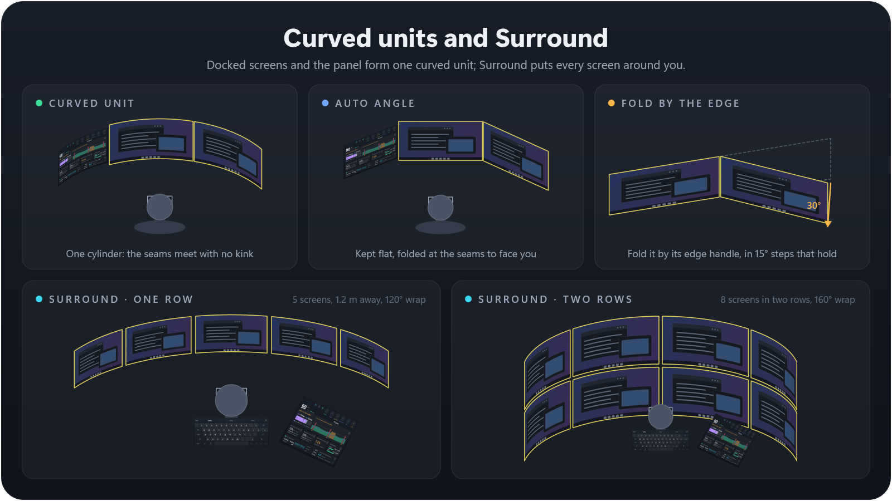

### The wristwatch
- Eight looks: Chronograph, Sport, Smart, Diver, Mini panel, Band, Skeleton (turning gears) and Holo HUD.
- Time, FPS with the last frames, CPU, GPU and VRAM use, batteries and what's playing, at your headset's refresh rate.
- Buttons for the panel, the keyboard, your screens and your media. Grab it to put it on either wrist or anywhere in the room, size it, bend its strap round your wrist, lock it.
- Cable turns: how often you've turned one way, so the headset cable never tangles (no drift; click it when the cable is straight). Also on the panel, and as an optional floor ring.
- Show when: always, or only while you look at your wrist.

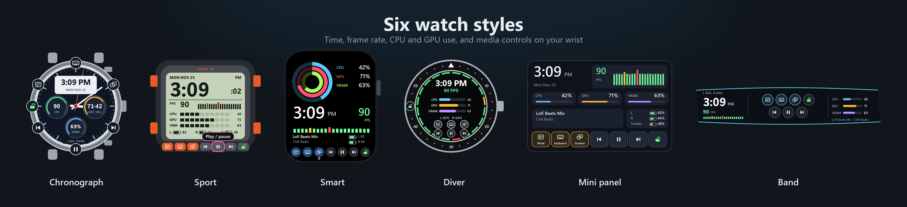

### Keyboard and voice
- A VR keyboard that types in 5.4 ms from trigger to keystroke (median; SteamVR's keyboard: 22.7 ms on the same rig).
- Compact, 75%, TKL or full size; QWERTY, AZERTY, QWERTZ and Dvorak; symbols, emoji, text shortcuts and word suggestions.
- Type with either laser, the controller tips, or your eyes. Themes, accent colors, key sounds and haptics. Lock it in place, gaze fade.
- Voice typing on your own GPU with NVIDIA Nemotron: hold to talk, tap or hold, or hands-free, from the keyboard or any screen's bar. Windows speech as a fallback.

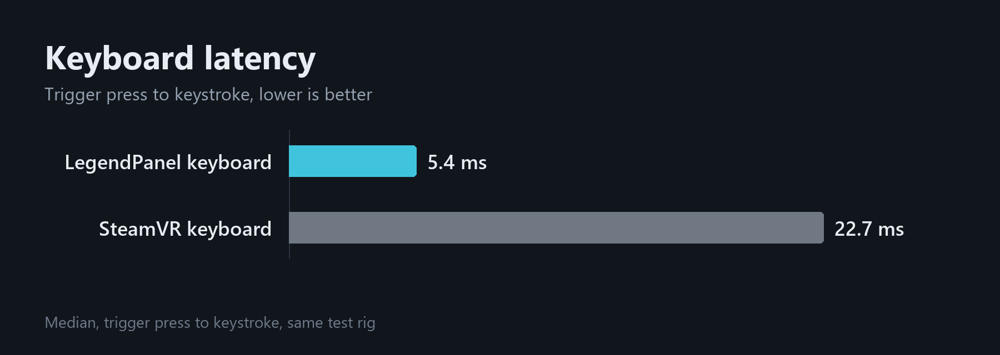

### Binds and Game mode
- Every bind on one page, in VR and on the desktop: LegendPanel's actions, Game mode buttons, key binds and pictures of your controllers.
- Any key, mouse button, wheel, media key, or one of your action buttons and macros, from grouped menus. Binds never clash. Learn and Record.
- Key binds: hold controller buttons, or a mouse side button, to hold any key or combo (push-to-talk, hotkeys).
- Game mode per screen: your controllers become an Xbox controller for that game while your laser is on it, and your VR game stops seeing them. Two styles: your own binds (keys, mouse, macros) for PC apps, or a plain controller with the standard layout for emulators. Sticks as gamepad all the time. Needs the free ViGEmBus driver.

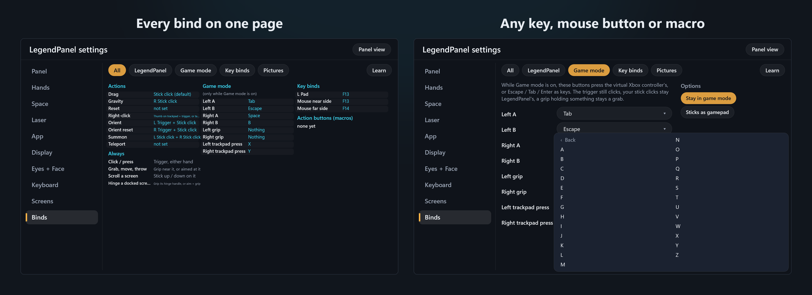

### Aim, click and grab
- The laser clicks, right-clicks (tap the trackpad low), middle-clicks (tap its top) and scrolls in any window.
- Trigger-pressure stabilization steadies the ray as you squeeze; button snap pulls the selection to the nearest button.
- Kinetic physics: throw panels and screens and they fly on and dock where they land. Grab handles appear where your hand is.
- Lock the panel, the keyboard, any screen or the watch so nothing moves it.

### Playspace
- 6DOF orient: tilt, turn and roll your whole playspace with a chord, snap back with another.
- Teleport: hold, aim the arc, let go. Glide or jump, or one button for teleport and drag.
- Space drag with momentum, friction and gravity, stick turn, Fix floor and Reset space.
- Summon: click both sticks and the panel (or the watch) comes to you.

### Eyes and face (with LegendEye)
- Eye control of the panel: look to press, eye typing, a cursor that follows your eyes, calibration that keeps tuning itself.
- LegendEye's tracking from the panel: pause, start and recenter; face tracking, expressions and face smoothing; foveated rendering presets.

### Media, sound and actions
- Now playing with previous, play / pause and next; master volume, a slider per app, output device and mic mute.
- Action buttons: open an app, file or web page, press a hotkey, run a macro.

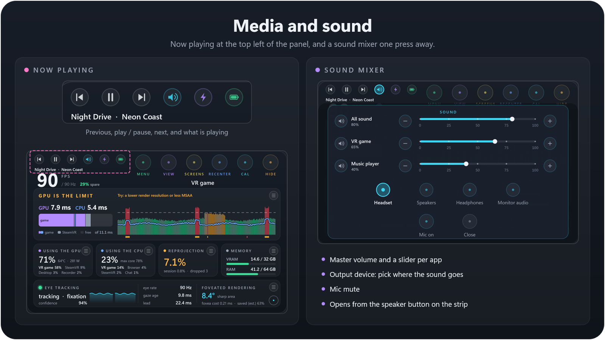

### Look and comfort
- 16 laser colors plus custom, 8 beam styles, pointer cursors, a clock and calendar.
- Show when, for the panel, the watch, each screen and the keyboard: always, head turn or eye look, with its own angle, stay time, and faint or gone when away.
- Themes and skins: 24 themes and 28 live GPU skins (any color, animated or still) for the panel, the watch and the keyboard, each on its own.
- Eye comfort: brightness down to 5 % and color temperature in kelvin. Night mode: warmer and dimmer after sunset, from set times or your location. Headset test images: sharpness, grid, colors, contrast, dark steps.

### The menu
- Every setting in VR and in the desktop window, with an explanation on hover. Settings search finds any of them, by keyword or (optional, on your PC) by meaning. Without eye control, the panel's Menu opens the full menu in VR; with it, the eye-tracked menu.
- A tutorial on the first start and with each new version, and settings backup with undo.

## What's new in 4.0

- **15 common languages:** from your Windows language or App > Language; it switches instantly.
- **Settings search:** a search box in the menu. Type or say it; results show where each setting lives. Optional local semantic search finds settings by meaning, entirely on your PC.
- **Themes and skins:** 24 themes and 28 skins drawn live on your GPU, any color, for the panel, the watch and the keyboard. The menu floats on glass so it stays readable.
- **Watches:** Skeleton (with a glass caseback, an optional real 3D movement in stereo and a choice of plates) and Holo HUD. Every watch gets Recenter and Volume, and a Screens list to show, hide or add screens.
- **CPU per core:** every core's load, numbered, with its own graph.
- **Menu icons:** on every menu button and the panel's own buttons.
- **Night mode:** warmer and dimmer after sunset, from set times or your location. Temperature in kelvin.
- **Screens:** tilt with grip + trigger, keyboard on text fields, docked screens and the keyboard match curves, resizing keeps docked edges lined up.
- **Comfort:** color-blind modes, a playspace center marker on the floor, key binds on either hand.
- **Steady hold and clicks:** advanced filtering keeps held panels and screens steady; clicks land where you aimed, with lower latency.

[Full 4.0 notes](RELEASE_4.0.0.md)

## What's new in 3.1

- **Show when:** the panel, the watch, screens and the keyboard can each show only while you look at them (head turn or eye look), with their own angle, stay time, and faint or gone when away. The watch can now hide until you look at your wrist.
- **Cable turns:** counts your turns one way so the headset cable never tangles. No drift (playspace turns and recentering never change it). On the watch and the panel past a set number of turns, plus an optional floor ring. Click the tag or the chip when the cable is straight. Off on wireless headsets.

[Full 3.1 notes](RELEASE_3.1.0.md)

## What's new in 3.0
- Hinged assemblies: one handle per joint, push / pull or stick to fold both sides, Lock edge to bend both.
- The wristwatch, in six looks.
- Every bind on one page, with any key, mouse button or macro.
- Snap screens, the keyboard and the panel to the body trackers you pick.
- 6DOF orient, teleport, kinetic physics panels and space drag with gravity.
- A 5.4 ms keyboard, and voice typing on your GPU with three modes.
- Eyes + Face controls for LegendEye, and an Auto menu that opens the full menu in VR.

[Full 3.0 notes](RELEASE_3.0.0.md)

## Requirements
- Windows 10 or 11 (64-bit)
- SteamVR
- Any SteamVR headset. Index, Quest/Touch, Vive, Windows Mixed Reality, Cosmos and Reverb G2 controllers are supported.
- For eye tracking, the eye-tracked menu and the LegendEye remote: [LegendEye](https://github.com/Encapsulation/LegendEye) 5.0 or later

## Getting started
1. Run LegendPanel.exe. It starts in the Windows tray, with no window.
2. Put on your headset. The first time, the panel asks whether to start with SteamVR. Look at **Yes** or point your laser at it.
3. Turn your left wrist toward you to see the panel. Squeeze the grip with your other hand to pick it up and move it. Let go on a wrist to wear it there, or anywhere else to leave it in the room.

You can also open the panel from its button in the SteamVR dashboard's bottom bar, and change every setting from the tray icon.

## Earlier releases

2.0 to 2.0.4

### What's new in 2.0.4

### Fixes
- LegendPanel now closes with SteamVR when SteamVR started it. Before, it kept running after SteamVR closed, and Steam showed SteamVR as still running and refused to start it again.
- When SteamVR starts LegendPanel, it now has a tray icon. Before, it ran with no window and no tray icon.
- Opening LegendPanel while it's already running now brings up its window. Before, nothing happened.
- A LegendPanel you open yourself stays open when SteamVR closes.

### What's new in 2.0.3

### Keyboard settings
- A **Keys** menu for the keyboard: open it with **Layout and size** on the **Keyboard** page. It holds the layout (QWERTY, AZERTY, QWERTZ, Dvorak), the keyboard size and the edit keys. **Back** returns to the keyboard's pages.
- Index fingers now sit with the other ways to type on the **Keyboard** page: Laser, Touch, Index fingers, Eyes and Eye assist.

### What's new in 2.0.2

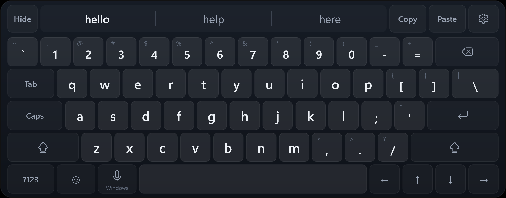

### Edit keys
- Copy and Paste keys in the VR keyboard's top bar, next to the gear, on every keyboard size. On by default.
- Cut, Select all and Undo can sit next to them. Off by default.
- One **Edit** button (in the keyboard's **Keys** menu since 2.0.3) switches between Copy and Paste, all five, or none.

### What's new in 2.0.1

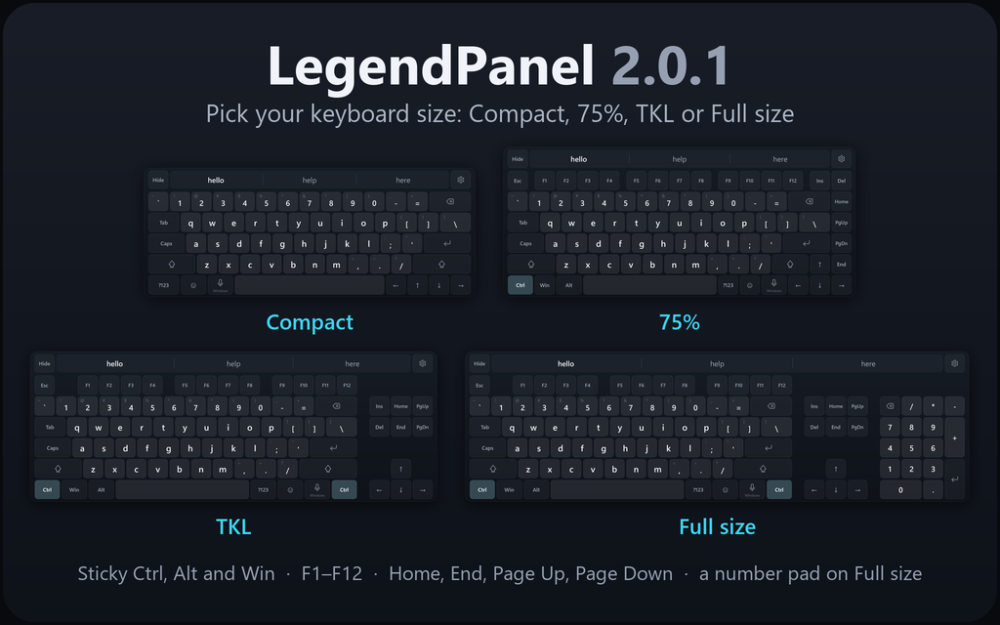

### Keyboard sizes
- Pick the VR keyboard's size with the **Size** button under **Keyboard**, next to the layouts: Compact (the 2.0 keyboard), 75%, TKL or Full size. The keys stay the same size; a bigger keyboard is just wider.
- **75%:** Esc, F1 to F12, Ctrl, Win and Alt, Ins and Del, Home, Page Up, Page Down and End down the right side, and the arrow keys in an inverted T.
- **TKL:** the full main keys, the Ins / Home / Page Up / Del / End / Page Down block and the arrow keys.
- **Full size:** everything on TKL plus a number pad.
- **Ctrl, Alt and Win** work like on XSOverlay: tap Ctrl, then C, to copy. Tap one twice quickly to keep it held, and tap it again to let go.
- Every size works with QWERTY, AZERTY, QWERTZ and Dvorak, with your eyes, the lasers and the controller tips, and still resizes with both hands.

### What's new in 2.0

### Screens
- Monitors and single app windows as overlays (Windows Graphics Capture), as many as you like, restored after a restart.
- Menus, dropdowns and dialogs that reach past a window's edge get overlays of their own: fully clickable, movable on their own, and docked back onto their window when you let go over it or beside one of its edges.
- Fast mirror: DXGI Desktop Duplication at the source's own frame rate (exclusive fullscreen included) for games, emulators and 3D apps, with low-latency laser updates paced to the headset's frames.
- Curve X and Y (seamless bands) and Auto curve (radius = distance × an adjustable ratio, sideways or both ways); width, opacity, brightness, contrast and tint.
- 3D: side-by-side and over-under, each half to its own eye, with swap eyes.
- Follow the active window; webcam and capture-card sources; optional Windows notifications as cards.
- A control bar under each screen, shown when your laser or your eyes come near it: keyboard, pin, curve, opacity, lock, close. It moves to whichever outer edge is free.
- Laser mouse: move, click and scroll. Lock a screen to make it click-through.
- Layouts: save and load screen arrangements, optionally per game. Bring here and RECENTER bring back lost screens. Optional gaze fade.

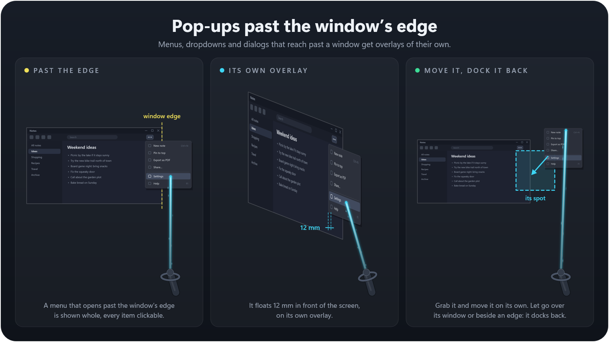

### Docking and moving
- Pin to the room, a wrist or your head. Dock on any side of the panel, another screen, XSOverlay or other wrist apps, facing the way you hold it (a quarter turn too), with a snap preview. Docked groups move, pin and dock as one.
- Screens docked side by side, and the panel beside them, form one curved unit. Or fold flat at the seams to face you (Auto angle). Fold any docked surface by its edge handle in 15° steps that hold.
- Surround: your screens around you in one or two rows, with adjustable distance and wrap.
- Throw (optional): let go while moving and it keeps going, with adjustable strength, friction, spin and range. It docks onto a wrist, a panel or a screen it passes.
- Two hands move, turn and resize anything you hold.
- Follow head: the panel and every screen can be Off, Lazy follow (adjustable dead zone, catch-up and height) or Locked to view. Several following surfaces tile without overlapping, wrapped around you or on a flat wall.

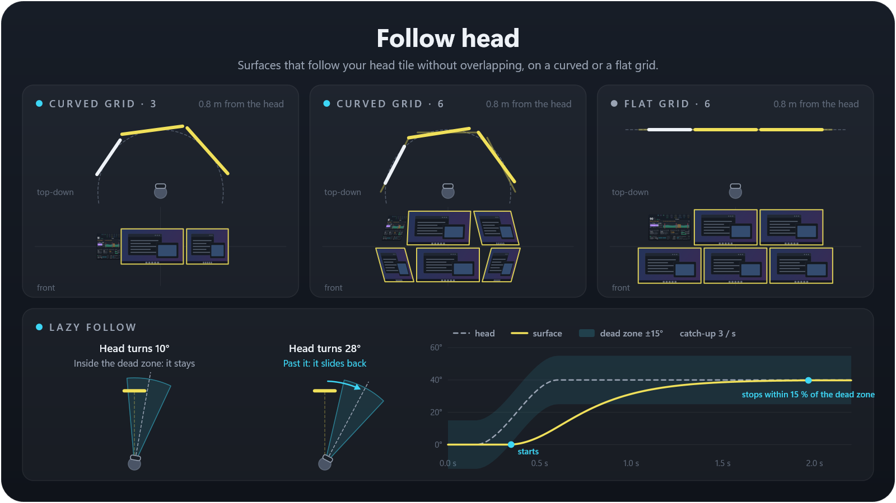

### VR keyboard and voice typing
- Full layout with number row, symbols and emoji; QWERTY, AZERTY, QWERTZ and Dvorak; text shortcuts; word suggestions from a 30,000-word model.
- Type with either laser, with the controller tips (drumstick), or with your eyes: free dwell, or assisted typing that weighs the gaze against the next likely letter and shortens the dwell for likely keys.
- Themes (Panel, Midnight, Light, Neon, Beige, Gray and Black caps), any accent color, key and board opacity, key sound packs (Soft, Thock, Creamy, Clacky, Clicky, Typewriter) and haptics.
- Opens under the screen you clicked. Dock it anywhere or pin it to either wrist; its button brings it back if it gets lost.
- Voice typing runs on your PC: NVIDIA Nemotron Speech Streaming 0.6B through NeMo-Speech.cpp, built into the exe. Live text while you speak; push to talk or hands-free (Silero VAD). It runs on Auto, the CPU or any GPU (Vulkan). The model (700 MB) downloads on first use and is verified. Windows speech is the fallback.

### Media, sound and actions
- Now playing with previous, play/pause and next at the top left of the panel.
- Sound: master volume, a slider per app, output device and mic mute.
- Action buttons: launch an app, file or web page, press a hotkey, run a macro, or trigger panel actions. Make them in VR or in the desktop window.
- Batteries show only when low; the device list holds 16 devices.

### Space drag and eye comfort
- Space drag: hold a thumbstick click, or buttons you record, and move your hand to move the playspace. Adjustable speed, momentum and optional gravity. Fix floor and Reset space sit beside it under **Tools**.
- Eye comfort: brightness down to 5 % and color temperature in half steps, cooler or warmer.

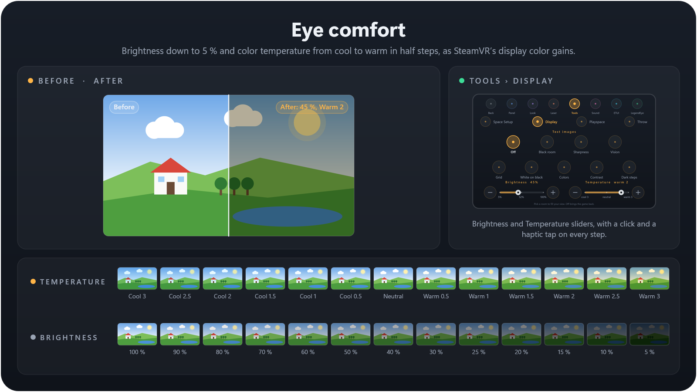

### Lasers and test images
- A color per hand, with buttons to copy one hand's color to the other. Six beam styles that look round from every side: Solid, Glow, Pulse, Rainbow, Dashed and Matrix. An optional shimmering cursor, and lasers that can stay on. The dot is its own overlay on the beam's tip, so it never lags behind the beam.
- Tooltips: rest your laser on any control to see what it does.
- Test images for checking your headset, all on dark backgrounds: sharpness charts, an eye chart with an astigmatism dial, a grid, white on black, colors, contrast and dark steps.

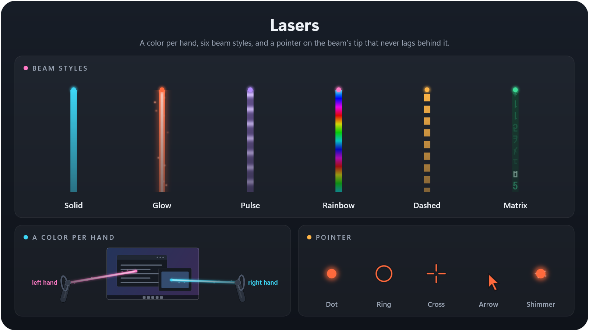

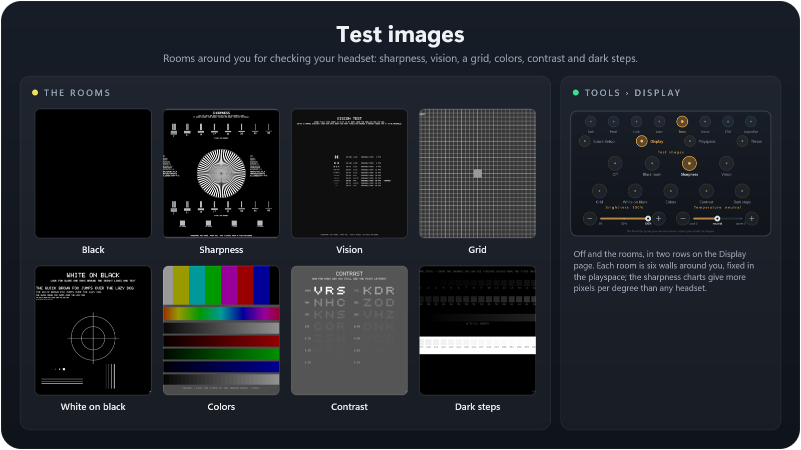

### The panel and its menu
- Menu redesigned: centered and symmetric, labeled slider stops you can press with your eyes, a click and a haptic tap on every slider step. Tabs: Panel, Look, Laser, Tools, Sound, ETUI, LegendEye.
- Tools: Space Setup, Display, Playspace, Throw.
- ETUI: one switch for eye control, look to press on its own switch, look time 0.3 to 3 s.
- Haptics: light, medium or strong, with optional taps on press and ticks on hover.
- Settings backup (save, load, undo) and an update check that only tells you.
- Six sound packs (new: Glass, Bubble), each with its own resize sound.
- VRAM in use on AMD and Intel GPUs.

## Settings
Settings are saved in `%LOCALAPPDATA%\LegendEye\info_panel.json`. Start with SteamVR can be turned on or off under **Tools** in the panel's menu or from the tray icon.

## License
Free to use. See [LICENSE.txt](LICENSE.txt) and [THIRD_PARTY_NOTICES.txt](THIRD_PARTY_NOTICES.txt).

## Demo (1.0)
A 2.0 demo is coming soon.

https://github.com/user-attachments/assets/a2c4e61c-8a13-4e4a-b75e-2e55a29b470a

## Star History
<a href="https://www.star-history.com/#Encapsulation/LegendPanel&Date">
  <picture>
    <source media="(prefers-color-scheme: dark)" srcset="https://api.star-history.com/svg?repos=Encapsulation/LegendPanel&type=Date&theme=dark" />
    <source media="(prefers-color-scheme: light)" srcset="https://api.star-history.com/svg?repos=Encapsulation/LegendPanel&type=Date" />
    
  </picture>
</a>
