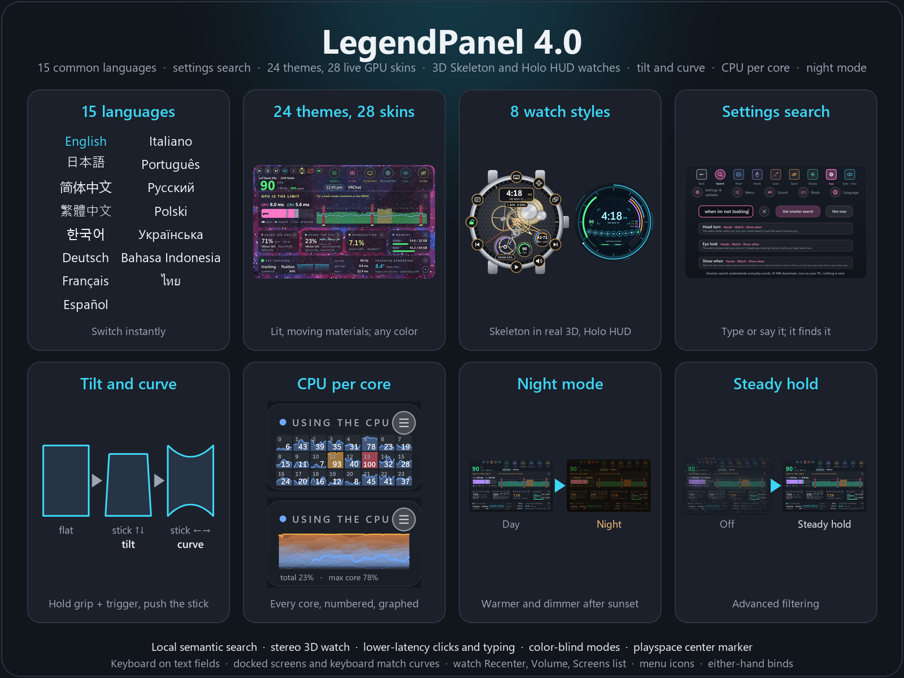

# LegendPanel 4.0.0

## 15 common languages
- English, 日本語, 简体中文, 繁體中文, 한국어, Deutsch, Français, Español, Italiano, Português (Brasil), Русский, Polski, Українська, Bahasa Indonesia and ไทย.
- It follows your Windows language, or pick one in App > Language. Everything switches at once: the panel, the menus, the watch, the keyboard, the screens and every tooltip.
- Each language is written in its own script on the Language page, and "Language" always stays in English, so you can always find your way back.
- Chinese, Japanese, Korean and Thai each use their proper Windows font. Dates are written the local way.
- Search works in your language too.
- Nothing gets cut off: long words shrink a little or go onto two lines.

## Settings search
- A search box at the top of the menu, in VR and on the desktop. Type, or say it with voice typing; the keyboard pops up when you click the box.
- Results show where each setting lives (for example Panel › Show when › Watch) and what it does. Click one to jump there.
- Local semantic search (optional): finds settings by meaning, so "when im not looking" finds Show when. A 91 MB download that runs entirely on your PC; nothing is sent. Say Not now and it stops asking.
- Click a tab, or an empty spot outside the box, to leave search.

## Themes and skins
- 24 themes, each with its own colors, set separately for the panel, the watch and the keyboard.
- 28 skins: 20 materials (carbon, brushed metal, satin, molten and more) and 8 specials, drawn live on your GPU with light and movement. Any color you like on each.
- Animation is optional and on by default.
- The menu floats on glass cards over the skin so it stays readable; Dim veils the skin instead if you prefer.

## Watches
- Skeleton: an open movement you can watch tick, with a real gear train from the mainspring barrel through the wheels to the escapement and the swinging balance wheel, driving the hands. Turn your wrist over to see it through the glass caseback.
- 3D movement (optional): the Skeleton's wheels, balance and bridges in real 3D, in stereo, seen from your eyes' own angle as you turn your wrist.
- Plate: pick the finish behind the wheels: perlage grey, black, blue or rhodium, Geneva stripes, gilt, your watch theme or your watch skin.
- Holo HUD: a glowing heads-up display. The watch now has eight looks.
- New buttons on every watch: Recenter, and Volume (press to mute; while pointing at it, the stick sets the level).
- The Screens button opens a list: show or hide all your screens or each one, close one, add a screen (a monitor, the active window or any open window), or go to the Screens page.
- All the watch's settings are in one place: Hands > Watch (look, show when, theme, skin, Skeleton).

## CPU per core
- The CPU card shows every core's load beside the total, numbered as in Task Manager, colored as it gets busy.
- Its ☰ button steps through views: every core as a numbered cell with its own graph, one graph with all cores and the busiest one, and what's using the CPU.

## Menus
- Optional icons on every menu button, in the VR menu, the desktop menu and the panel's own buttons (App > Menu > Icons; on by default).
- Settings for one thing now sit in one menu: the panel's look, the keyboard's look and the watch each have their own pages.
- Buttons are the same size and spacing throughout.
- The Screens page has its own Hide button, and Back takes you out.
- The desktop menu's size in VR can be changed (Menu size).
- Every click in the desktop menu makes the click sound.

## Screens and docking
- Your screens, in the desktop menu (Screens > Your screens): every open screen with Show / Hide, Keyboard, Settings, Recenter and Close, and tabs to add monitors and windows.
- Show or hide any screen without closing it, from the Screens page, the desktop menu or the watch.
- Tilt and curve: hold a screen, the panel or the keyboard with the grip and keep the trigger squeezed. The stick forward or back tilts it; left or right curves a screen. Pick what each direction does on Hands > Grab & throw.
- Docked screens take their parent's curve, sideways and up and down, so the edges meet. A docked keyboard curves with its screen too.
- Resizing a docked screen, keyboard or panel with both hands keeps it lined up along its edge.
- Hinging something docked on a curved screen keeps its curve (a toggle), and curved docked parts no longer clip into each other.
- Keyboard on text fields (optional): click into a text box on any screen and the keyboard opens, or comes to you.
- Whole group (optional): brightness, contrast, tint and opacity change every screen docked together.
- The bar: Reset curve and a 3D button on its More page. The bar grows with very large screens.
- A window running as administrator now says so, with Restart as admin in App > Settings so you can click it.

## Hands, clicks and comfort
- Steady hold (on by default): advanced filtering keeps a held panel, screen or keyboard steady in your hand. It still moves at once when you move, and stays put when you let go. Built on the latest research (a speed-adaptive filter for both moving and turning), with a strength slider (Hands > Hold).
- Steadier clicks: the click point defaults to 85 % of the trigger, and as you squeeze, the laser goes back to where it pointed just before your finger moved, so a quick click never drags.
- Lower latency for clicks and typing.
- Laser smoothing is light (20 %) by default on new installs, and follows fast moves more closely.
- Color-blind modes (App > Settings > Color vision): red-green, blue-yellow or mono, for LegendPanel's own colors.
- Playspace center marker (optional): a faint mark on the floor at the middle of your playspace, so you know where you are without lifting the headset.
- Key binds can be set to either hand.
- Gravity goes down to 0.1x.

## Voice typing
- The keyboard's mic key and each screen's Voice button now work the same way and show the same words: Hold to talk (or Tap or hold, Tap to talk), Loading voice…, Listening, Typing….
- The first press shows Loading voice… with a bar while the speech model loads. Keep holding (or tap once) and it starts listening as soon as it's ready; let go first and it doesn't.
- Problems such as no microphone show right on the button.

## Night mode
- Warmer and dimmer in the evening, with its own temperature and brightness, easing in and out.
- Set sunset and sunrise yourself, or Use my location (Windows location; nothing is sent anywhere).
- Off by default. Display > Night mode.
- Temperature is now in kelvin, warmer or cooler than normal.
- Display's first page is now Color: brightness and temperature on top, test images below.

## Fixes
- Fix floor's countdown shows in every menu style.
- The panel no longer starts following your head after you walk far from the playspace.

## Download
**LegendPanel.exe** below. VirusTotal: [0 of 68 security vendors flagged it](https://www.virustotal.com/gui/file/d3c8d4b90141faf980563db27bfd8770d64768b0caf90822056b34c890abd940). SHA256: `d3c8d4b90141faf980563db27bfd8770d64768b0caf90822056b34c890abd940`

Updating: replace LegendPanel.exe. Your settings are kept.
